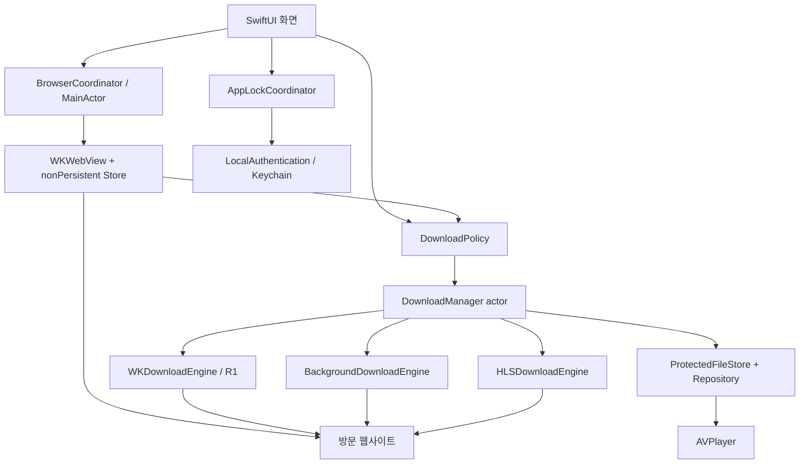
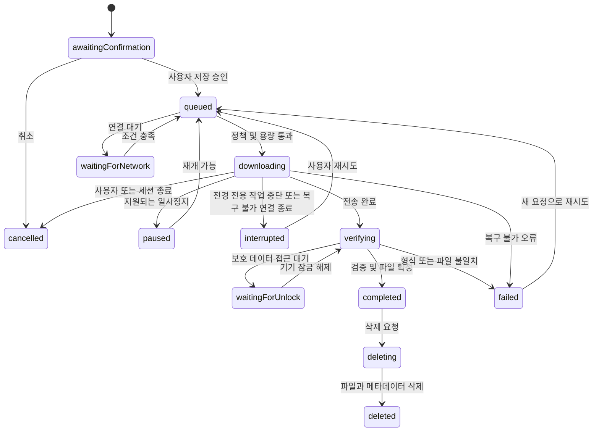

# Stream Browser — iPhone 개발 명세서 v1.0

작성일: 2026-11-13 · 문서 상태: 구현 기준 제안 · 대상: 기획, iOS 개발, QA, 보안 검토

> 현재 배포 기준은 **Windows PC + 개인 iPhone 설치**로 변경되었다. 배포·개발 환경·출시 조건은 [v1.1 변경 명세](./Stream-Browser-개인설치-변경명세-v1.1.md)를 우선 적용한다. 아래 App Store 관련 내용은 향후 공개 배포 시 참고한다.

> 첫 버전의 보호·편의 기능과 추가 인수시험은 [보완 기능 명세 v1.2](./Stream-Browser-보완기능-v1.2.md)를 함께 적용한다. Brave 다운로드 코드 선별은 기존 보안·브라우저 요구사항을 제거하지 않는다.

## 1. 제품 정의와 결정 사항

Stream Browser는 웹을 탐색하면서 기기에 남기는 정보를 최소화하고, 저장이 허용된 동영상 파일을 사용자의 명시적 선택으로 내려받아 오프라인으로 보는 iPhone 브라우저다.

사용자가 확정한 방향은 **iPhone, 프라이버시·보안 우선, 특정 영상 서비스에 종속되지 않는 범용 브라우저부터 개발**이다. 이 문서는 해당 요구로 새로 작성한 명세이며, 이전 공유 링크의 원문을 개정한 문서는 아니다.

아래는 개발을 시작할 수 있도록 정한 제안 기본값이다. 배포 방식, 최소 OS, 사업 모델, 지원 사이트는 추후 변경할 수 있지만 보안 요구사항을 약화하는 변경에는 영향 분석과 재시험이 필요하다.

| 항목 | 제안 결정 | 이유 |
|---|---|---|
| 배포 | 한국어 우선 App Store 앱 | 일반 iPhone 사용자가 설치 가능한 경로 |
| 대상 기기 | iPhone 우선, iPad 최적화 후속 | 초기 실기기 검증 범위 축소 |
| 최소 OS | iOS 18 이상을 초기 후보로 설정 | 착수 시 사용자 기기 범위·SDK 지원을 확인하여 확정 |
| 개발 | Swift 6 언어 모드, SwiftUI + WKWebView | 네이티브 권한·저장소·다운로드·접근성 활용 |
| 빌드 | 출시 시 Apple 제출 요건을 충족하는 정식 Xcode/SDK | 최소 지원 OS와 제출 SDK 버전은 별개 |
| 탐색 기본값 | 비공개 세션만 제공하는 첫 버전 | 기록 유지 모드와의 혼동 및 데이터 혼합 방지 |
| 서버 | 핵심 기능용 자체 서버 없음 | 방문 URL·영상·쿠키가 개발사 서버를 경유하지 않음 |
| 계정·수익화 | 계정, 광고 SDK, 분석 SDK 없음; 결제는 별도 결정 | 불필요한 개인정보·추적·운영 복잡도 감소 |
| 첫 다운로드 | 직접 HTTPS 파일, 공개 파일 백그라운드 저장, 허가된 비DRM HLS VOD | 웹 로그인 세션과 시스템 전송을 분리 |
| 후속 다운로드 | 웹페이지 영상 후보 탐지 | 직접 파일과 HLS 입력 경로를 먼저 검증 |

**출시의 의미:** 모든 웹사이트 호환이나 모든 동영상 저장이 아니라, 명시된 지원 범위에서 재현 가능한 탐색·저장·삭제·보안 동작을 제공하는 것이다. 문서의 수치들은 측정된 성능이 아닌 제안 합격 기준이다.

## 2. 성공 기준과 범위

### 2.1 사용자 가치

1. 앱을 열면 계정 가입 없이 즉시 탐색할 수 있다.
2. 세션 종료 후 방문 기록·쿠키를 다시 불러오지 않는다.
3. 저장 가능한 파일과 저장 불가능한 콘텐츠를 구분해서 설명한다.
4. 저장한 영상은 비행기 모드에서도 재생한다.
5. 무엇이 남고 무엇이 삭제되는지 사용자가 예측할 수 있다.

### 2.2 릴리스 구분

| 단계 | 필수 범위 | 제외 범위 |
|---|---|---|
| R0: 기술 검증 | WKWebView, 비영속 저장소, 앱 전환 가림, WKDownload, 파일 보호, 실기기 중단 복구 | 서비스별 추출기, 디자인 완성도 |
| R1: 첫 개인 사용판 | 비공개 브라우저, 직접 파일 저장, 공개 파일 백그라운드 저장, 허가된 비DRM HLS VOD 보관, 로컬 재생, 앱 잠금, 삭제·내보내기, 추적 차단 | 일반 모드, 클라우드 동기화, HLS 라이브 녹화·MP4 변환 |
| R2: 콘텐츠 확장 | 허가된 출처의 영상 후보 표시, 사이트별 세션 권한 선택 | 비공개 쿠키의 백그라운드 세션 이식, DRM 우회 |

R1은 브라우저 보호, 직접 파일 다운로드, 백그라운드 다운로드, HLS 오프라인 보관이 모두 인수시험을 통과하면 완료한다. 브라우저 보안 기반을 먼저 완성한다.

### 2.3 첫 버전의 명시적 비목표

- YouTube·SNS 등 특정 서비스에서 추출하는 기능, URL 서명 해독, 페이월 우회, DRM 해제.
- VPN, Tor, 자체 DNS 프록시, IP 은닉, 완전한 지문 방지, 악성 사이트 100% 탐지.
- 자체 비밀번호 관리자, 계정 동기화, AI 페이지 분석, 클라우드 영상 변환.
- 크롬 확장 프로그램, 원격 JavaScript 플러그인, 임의 스크립트 실행 기능.
- 모든 형식의 파일 관리자, 임의 파일 자동 실행, 백그라운드 오디오를 이용한 앱 생존 유지.

## 3. 플랫폼·배포 제약

### 3.1 브라우저 엔진

전 세계 기본 배포안은 WKWebView를 사용한다. Apple의 대체 엔진 제도는 지역·자격 조건이 있으므로 본 프로젝트의 기본 전제로 삼지 않는다. 이는 App Review 2.5.6에 근거한 선택이다. [S1]

WKWebView를 사용한다고 Safari와 기능·추적 방지·비밀번호·확장 프로그램 동작이 같아지는 것은 아니다. 실제 지원 범위는 자체 호환성 표로 관리한다.

### 3.2 동영상 다운로드의 허용 범위

App Review 5.2.3은 제3자 출처의 허가 없는 미디어 저장·변환·다운로드를 제한한다. 공개 URL, 로그인 성공, DRM 부재, 사용자의 “권한이 있습니다” 체크만으로 출처 허가를 입증했다고 간주하지 않는다. [S1]

제품 정책은 다음과 같다.

- 다운로드 지원 대상으로 홍보하거나 별도 연동하는 서비스는 출처의 다운로드 허용 근거를 보관한다.
- 웹사이트가 제공하는 공식 다운로드 링크, 개발사 소유 시험 콘텐츠, 허가된 콘텐츠 제공자의 직접 파일을 우선 검증한다.
- 범용 파일 저장 동작도 심사 판단 대상임을 전제로 설명 자료와 실제 동작을 일치시킨다. 승인 보장은 하지 않는다.
- 임의 페이지의 재생 트래픽을 가로채 영상 URL을 추출하는 기능은 R1에 넣지 않는다.
- 출처·약관 확인이 필요한 서비스는 지원 목록에 추가하기 전에 별도로 검토한다.
- 심사에서 숨긴 기능, 심사 후 다운로드 기능을 켜는 원격 플래그를 사용하지 않는다.

### 3.3 운영체제의 다운로드 한계

WKDownload와 URLSession 백그라운드 세션은 같은 실행 모델이 아니다. R1의 WKDownload에 백그라운드 지속을 약속하지 않는다. 백그라운드 URLSession도 사용자가 앱을 강제 종료하면 시스템이 전송을 취소하며 자동 재실행하지 않는다. 정상적인 시스템 종료와 사용자 강제 종료를 별개 상태로 처리한다. [S3][S4]

## 4. 사용자 흐름과 화면 명세

### 4.1 화면 목록

| 화면 | 필수 요소 | 빈 상태·실패 상태 |
|---|---|---|
| 시작 안내 | 비공개 세션 설명, 저장 파일은 남는다는 설명, 앱 잠금 설정 | 권한 요청을 한꺼번에 표시하지 않음 |
| 브라우저 | 주소/검색, 뒤로·앞으로, 새로고침·중지, 탭, 저장함, 사이트 정보 | 오프라인, HTTP 차단, 인증서 오류, 웹 프로세스 종료 |
| 탭 목록 | 제목·현재 도메인, 새 탭, 개별 닫기, 세션 종료 | 열린 탭 없음, 탭 한도 도달 |
| 사이트 정보 | 실제 호스트, 연결 상태, 차단 규칙 상태, 세션 권한 | 보호 규칙 로드 실패, 기능 제한 이유 |
| 다운로드 확인 | 파일명, 출처 호스트, 형식, 크기 또는 알 수 없음, 저장 위치, 전경 필요 여부, 공개 파일의 백그라운드 저장 선택, HLS 앱 내 오프라인 보관 표시 | 저장 미지원, 출처 확인 필요, 용량 부족 |
| 다운로드 대기열 | 상태, 일반 파일 바이트·HLS 진행률, 취소·재시도, 지원될 때만 일시정지·재개 | URL 만료, 서버 거부, 재개 불가, 파일 검증 실패, 잠금 해제 대기 |
| 저장함 | 목록, 검색, 정렬, 재생, 이름 변경, 삭제, 내보내기 | 저장 파일 없음, 잠금 상태, 파일 손상 |
| 플레이어 | 재생·일시정지, 탐색, 볼륨·자막 등 시스템 제공 기능 | 지원하지 않는 코덱, 파일 손상 |
| 개인정보·설정 | 앱 잠금, 세션 종료, 모든 데이터 삭제, 백업 정책, 저장공간, 버전 | 삭제 실패·재시도, 기기 암호 미설정 |

### 4.2 탐색

1. 새 실행은 빈 비공개 세션으로 시작한다. 검색엔진을 처음 선택하기 전에는 자동 외부 연결을 하지 않는다.
2. 주소로 해석할 수 있는 입력은 HTTPS로 연다. 검색은 사용자가 제출했을 때만 선택한 검색엔진으로 전송한다.
3. 자동완성은 로컬 북마크만 사용한다. 원격 검색 제안과 클립보드 자동 읽기는 R1에서 사용하지 않는다.
4. 주소창은 현재 최상위 문서의 호스트를 표시한다. 페이지 제목·HTML로 주소창 또는 보안 표시를 구성하지 않는다.
5. 주소 편집 시 전체 URL을 확인할 수 있다. 길거나 혼동 가능한 국제화 도메인은 실제 호스트를 확인할 상세 표시를 제공한다.
6. HTTP 입력은 HTTPS로 시도한 후 실패하면 중단한다. R1에는 HTTP로 되돌아가는 버튼이나 인증서 경고 우회가 없다.
7. 사용자가 누른 새 창 링크만 새 탭 후보로 취급한다. 자동 팝업을 제한하고 탭 수 상한을 적용한다.
8. 결제·로그인 리디렉션 등 정상 흐름과 팝업 차단의 충돌을 호환성 시험에 포함한다.

### 4.3 다운로드와 저장

1. 사용자가 사이트의 다운로드 링크를 누르거나 허용된 직접 파일 URL의 저장을 선택한다.
2. 앱은 서버 응답·저장 정책·지원 형식으로 후보를 판단하고 네이티브 확인 화면을 띄운다. MIME만으로 허용 판정하지 않는다.
3. “저장한 파일은 비공개 세션을 닫아도 남습니다”를 표시한다.
4. 사용자가 저장을 누른 뒤 정책에 맞는 엔진을 선택한다. 일반 파일은 보호된 staging에 기록한다. HLS는 시스템이 지정한 위치에 보관한다.
5. 전송 완료 후 형식·크기·재생 가능성을 검증한다. 일반 파일은 최종 경로를 확정하고, HLS는 시스템이 제공한 로컬 자산 참조와 저장한 트랙을 등록한다.
6. 저장 완료 후 원래 다운로드 URL, 인증 헤더, resume data는 제거한다. 출처 도메인만 기본 보관한다.
7. 저장함에서 오프라인 재생한다. 외부로 내보내려면 앱 잠금 해제 후 별도 행동이 필요하다.

크기나 화질을 알 수 없으면 “알 수 없음”으로 표시한다. 페이지에 없는 화질을 만들어 제안하거나 확장자만 바꿔 변환했다고 표시하지 않는다.

### 4.4 비공개 세션 종료와 데이터 삭제

- “탭 닫기”: 해당 WebView를 제거한다. 같은 세션의 다른 탭이 있으면 세션 쿠키는 유지될 수 있다.
- “비공개 세션 종료”: 모든 탭, 세션 WebView·data store 참조, 세션 자격 증명과 진행 중 비공개 다운로드를 종료한다. 완료 파일·북마크와 별도로 승인한 공개 백그라운드 작업은 유지되며, 작업 목록에서 각각 취소할 수 있다.
- “저장 파일 삭제”: 파일, 썸네일, 메타데이터, 임시 내보내기 복사본을 함께 제거한다.
- “앱 데이터 모두 삭제”: 작업 취소, 세션 종료, 파일·북마크·설정·앱이 관리하는 Keychain 항목 삭제 후 빈 상태로 전환한다.
- 파일 삭제와 전체 삭제에는 대상·개수를 보여 주는 확인이 있다. 첫 버전은 숨은 휴지통을 두지 않는다.
- 실패 항목이 있으면 성공으로 표시하지 않고 재시도 상태를 제공한다. OS가 관리하는 잔여 데이터의 즉시 물리 소거는 보장하지 않는다.
- 이미 사진·파일 앱·다른 앱으로 내보낸 사본은 삭제 대상이 아니라고 설명한다.

## 5. 프라이버시 계약

### 5.1 사용자에게 약속할 수 있는 내용

- 기본 탐색 세션은 앱의 영속 방문 기록으로 저장하지 않는다.
- 개발사 서버로 방문 URL·검색어·쿠키·영상 파일을 보내지 않는다.
- 광고 식별자, 행동 분석 SDK, 세션 녹화 SDK를 포함하지 않는다.
- 다운로드·북마크 등 사용자가 명시적으로 저장한 데이터는 기기에 남는다.
- 웹사이트·검색엔진·통신망은 요청을 처리하면서 IP 및 요청 정보를 볼 수 있다.

“완전 익명”, “기기에 흔적이 전혀 없음”, “추적 완전 차단”, “군사급 암호화” 같은 검증 불가능한 표현은 사용하지 않는다.

### 5.2 데이터 목록과 보존 기간

| 데이터 | 저장 위치 | 기본 보존 | 외부 전송·삭제 |
|---|---|---|---|
| 현재 탭 URL·제목·뒤로가기 상태 | 메모리 | 현재 세션 | 목적 웹사이트로만 요청; 앱의 복원 파일에 저장하지 않음 |
| 사이트 쿠키·캐시·웹 저장소 | 비영속 WKWebsiteDataStore | 해당 세션 | 필요한 웹 요청에만 사용; 세션 종료 시 참조 폐기·정리 |
| 방문·검색 기록 | 별도 영속 저장 없음 | 없음 | 검색은 제출 시 선택한 검색엔진에 전송 |
| 북마크 | 보호된 로컬 DB | 사용자가 삭제할 때까지 | URL이 남는다는 안내 후 저장; 자동 동기화 없음 |
| 완료한 영상·파일명 | 보호된 앱 내부 저장소 | 사용자가 삭제할 때까지 | 자동 업로드 없음; 내보내기만 사용자 선택 |
| 썸네일 | 보호된 내부 경로 | 파일 삭제 또는 캐시 정리까지 | 로컬에서 생성; R1 기본 목록은 아이콘 표시 |
| 진행 중 URL·인증 정보 | WebKit 세션 메모리와 엔진 임시 데이터. 공개 백그라운드 요청은 iOS가 별도로 관리 | 비공개 요청은 해당 세션·작업 수명, 공개 요청은 시스템 작업 수명 | 앱 로그·일반 DB에 전체 URL과 자격 증명을 저장하지 않음. 공개 작업에는 인증 헤더·토큰·비공개 쿠키를 전달하지 않음 |
| 비민감 설정 | 로컬 설정 | 설정 초기화까지 | 자동 전송 없음 |
| 오류 진단 | 메모리 중심의 구조화된 오류 코드 | 세션 또는 테스트 실행 | 자동 수집 없음; 지원용 내보내기는 미리보기 후 선택 |

Apple의 nonPersistent는 웹사이트 데이터를 메모리에 저장하는 비영속 저장소다. 앱 자체 로그·다운로드·OS 진단 기록까지 모두 없앤다는 뜻으로 확대 해석하지 않는다. [S2]

북마크 저장 전 URL의 사용자 정보·서명 토큰 가능성을 표시하고 민감 링크는 기본적으로 저장하지 않는다. 검색 파라미터를 일괄 삭제하면 링크가 깨질 수 있으므로 사용자가 검토할 수 있어야 한다.

### 5.3 백업·외부 노출

- 재다운로드 가능한 미디어·캐시·전송 임시 파일은 백업에서 제외하고, 이동·복사 이후 속성을 재검증한다. [S10]
- 북마크처럼 사용자가 만든 데이터는 미디어와 별도 정책으로 관리한다. R1의 “이 기기에서만 보관” 선택에 맞춰 백업 제외를 적용하고 손실 가능성을 알린다. 실제 백업 복원 시험 없이는 백업 제외를 보장하지 않는다.
- iCloud 컨테이너·CloudKit·iCloud Keychain 동기화 기능을 추가하지 않는다.
- 파일 공유, Documents 자동 공개, Spotlight·Siri 기부, Handoff, 최근 문서 노출은 R1에서 사용하지 않는다.
- OS의 진단·백업·네트워크 기록을 앱이 모두 통제할 수 있다고 설명하지 않는다.
- 앱 삭제·기기 분실 시 내부 파일을 복구할 수 없을 수 있으므로 내보내기를 제공한다.

## 6. 기능 요구사항

| ID | 요구사항 | 완료 조건 |
|---|---|---|
| BR-01 | HTTPS 주소 탐색·검색·뒤로·앞으로·새로고침·중지 | 정상·오류·오프라인 상태에서 버튼 상태가 일치 |
| BR-02 | 비공개 다중 탭 | R1 기본 최대 20개; 종료·재실행 후 복원되지 않음 |
| BR-03 | 네이티브 주소·도메인 표시 | 리디렉션·SPA 이동·전체화면 종료 후 실제 호스트와 일치 |
| BR-04 | 기본 로컬 추적 차단 | 번들 규칙 컴파일·적용; 실패 시 보호 중이라고 표시하지 않음 |
| BR-05 | 사이트 호환성 선택 | 차단 해제는 현재 세션·명시한 사이트에 한정; 전역 해제 없음 |
| BR-06 | 북마크·페이지 찾기·공유 | 명시적 저장·전송 행동; 공유 시 전체 URL 확인 가능 |
| DL-01 | 허용된 HTTPS 직접 파일 저장 | 테스트 MP4의 다운로드·검증·오프라인 재생 성공 |
| DL-02 | 큐·취소·재시도 | 기본 동시 전송 2개, 대기열 20개; 초과 시 이유 표시 |
| DL-03 | 중단 복구 | 서버·엔진이 지원할 때만 재개, 아니면 처음부터 재시도 명시 |
| DL-04 | 파일명·형식·공간 검사 | 서버 입력으로 저장 루트 탈출·기존 파일 덮어쓰기 불가 |
| DL-05 | 완료 검증 | 오류 HTML·불완전 파일이 정상 영상으로 등록되지 않음 |
| DL-06 | 공개 파일 백그라운드 다운로드 | 홈 화면 전환·화면 잠금 중 전송과 시스템 종료 후 작업 재연결을 실기기로 확인 |
| DL-07 | 비DRM HLS VOD 오프라인 보관 | 저장한 HLS를 앱 재실행 후 비행기 모드에서 재생하고 삭제할 수 있음 |
| LIB-01 | 저장함·검색·정렬·이름 변경 | 로컬 동작, 표시 이름과 실제 저장 키 분리 |
| LIB-02 | AVPlayer 기반 오프라인 재생 | 비행기 모드에서 검증 영상 재생·탐색 |
| LIB-03 | 일반 영상 파일 내보내기·사진 저장 | 잠금 해제 후 선택한 일반 영상 파일만 전달. 사진 저장에는 add-only 권한 사용 |
| PR-01 | 방문 기록 미저장·세션 정리 | 앱이 제어하는 저장소·로그에 테스트 방문 문자열 잔존 없음 |
| PR-02 | 앱 잠금·앱 전환 화면 가림 | 모든 진입 경로와 재활성화 시 잠금 우회 없음 |
| PR-03 | 데이터 삭제 | 관련 파일·DB·캐시·작업 상태 삭제 검증 |
| PR-04 | 텔레메트리 없는 기본값 | 빈 시작 화면에서 앱이 시작한 외부 네트워크 요청 없음 |
| SEC-01 | TLS·브리지·파일 경계 | 10절 보안 조건과 별도 검증 계획 통과 |
| A11Y-01 | 접근성·한국어·가로 방향 | VoiceOver·큰 글씨·키보드/포커스·회전 흐름 통과 |

## 7. 다운로드 호환성 계약

| 콘텐츠 유형 | R1 | 처리 방식·제약 |
|---|---|---|
| 허가된 HTTPS MP4 직접 응답 | 지원 | 첫 공식 검증 조합은 H.264/AAC; 컨테이너와 코덱은 별도 판정 |
| MOV 등 다른 네이티브 재생 형식 | 조건부 | 실기기 표에 통과한 조합만 지원으로 표시 |
| 로그인 쿠키가 필요한 공식 다운로드 | 조건부 | 동일 비공개 WebKit 세션의 WKDownload; 별도 URLSession에 쿠키 복사하지 않음 |
| 일회성·서명 URL | 조건부 | 유효 기간 내 실행; 만료 시 페이지에서 새 링크 획득; 저장 URL 재사용 보장 없음 |
| POST·사용자 세션에 묶인 다운로드 | 조건부 | WebKit이 제공하는 다운로드 경로만 검증; 임의 GET 재작성 금지 |
| 허가된 비DRM HLS VOD | R1 지원 | 검증된 공개 HTTPS `.m3u8` 또는 출처의 명시적 저장 링크로 입력. AVAssetDownloadURLSession로 앱 내 오프라인 보관 [S5] |
| 검증된 공개 HTTPS 파일의 백그라운드 저장 | R1 지원 | 인증이 필요 없는 지정 출처. 사용자가 작업마다 선택 |
| HLS 라이브·DRM 콘텐츠 | 미지원 | 라이브 녹화·DRM 추출·키 우회 없음 |
| blob:·MSE·암호화 플레이어·교차 출처 iframe | R1 미지원 | 일반 다운로드 URL이라고 간주하거나 전역 네트워크 후킹하지 않음 |
| 영상 웹페이지 URL | 파일로 직접 저장하지 않음 | 페이지 보기; 지원되는 명시적 다운로드 링크 이용 |
| HTTP 파일·TLS 오류 | 미지원 | 보호 설정 해제 없이 실패 설명 |

WKWebView는 모든 하위 리소스 응답을 임의로 가로채는 범용 프록시가 아니다. WKURLSchemeHandler 또는 URLProtocol을 HTTPS 미디어 전체 감청 수단으로 전제하지 않는다. 기능 확장은 공개 API와 실제 장치 검증을 통해 별도 승인한다.

HEAD 요청이 차단되어도 파일 자체가 없다고 단정하지 않는다. 본 전송의 응답 헤더를 우선 사용하고, 추가 프로빙은 사용자 행동 이후 허용 출처에 한해 제한한다. Range 미지원, 알 수 없는 Content-Length, 압축 응답, 206/416, ETag 변경을 각각 처리한다.

## 8. 기술 구조

### 8.1 구성요소

앱은 사용자 파일과 URL을 개발사 중계 서버로 보내지 않는다. 향후 규칙 업데이트용 서버를 추가하면 별도 데이터 흐름·접속 로그·보존 정책을 다시 정의한다.

| 구성요소 | 책임 | 금지 사항 |
|---|---|---|
| BrowserCoordinator | 탭·탐색 정책·WebKit delegate·세션 수명 | 다운로드 DB 직접 수정 |
| PrivacySession | 비영속 store·세션 ID·정리·세션 예외 | 일반 모드와 공유 store 사용 |
| DownloadPolicy | 스킴·출처 정책·형식·엔진 선택·동의 결과 | 화면 상태만 믿고 작업 승인 |
| DownloadManager actor | 상태 전이·큐·중복 이벤트·취소·복구 | UI 스레드에서 대용량 I/O |
| DownloadEngine | 엔진별 실행·진행·중단·resume capability | 엔진별 차이를 숨긴 무조건 재개 |
| ProtectedFileStore | 내부 경로·원자적 확정·보호 속성·삭제 | 사용자 문자열을 실제 경로로 사용 |
| Repository actor | 메타데이터 트랜잭션·마이그레이션 | 쿠키·서명 URL·인증 헤더의 평문 저장 |
| AppLockCoordinator | 활성 상태·인증·가림·접근 제어 | 화면 잠금 상태와 파일 암호화 보장을 혼동 |

### 8.2 구현 방식

- SwiftUI 화면, UIViewRepresentable로 WKWebView 통합. 시스템 색상·SF Symbols·NavigationStack·List를 사용한다.
- WebKit/UI 접근은 MainActor에 둔다. 파일 작업·네트워크 상태 집계·DB 변경은 명시적인 actor 경계로 분리한다.
- 첫 버전은 Apple SQLite3 기반 소규모 repository 또는 동등하게 보호 속성·마이그레이션 검증 가능한 저장소를 사용한다. ORM 도입 여부는 R0에서 하나로 확정한다.
- 저장 경로는 Library/Application Support 하위 전용 디렉터리로 제한한다. staging·완료·썸네일·내보내기 임시 경로를 구분한다.
- 테이블/필드 숫자와 파일명에는 실제 URL을 넣지 않는다. 파일 키는 무작위 UUID다.
- 개발·테스트·릴리스 구성을 분리한다. 릴리스 WebView의 isInspectable은 false로 유지한다. [S11]
- 파일 형식·미디어 디코딩은 시스템 프레임워크 우선. FFmpeg 등 대형 네이티브 의존성은 R1에 추가하지 않는다.

### 8.3 브라우저와 네이티브의 신뢰 경계

범용 브라우저에 App-Bound Domains를 켜서 임의 웹 탐색을 유지할 수 있다고 가정하지 않는다. 해당 기능은 탐색 범위를 제한하는 목적이므로, 내부 신뢰 화면과 웹 탐색 화면을 별도 구성한다. [S12]

R1은 영상 탐지 JavaScript 브리지를 사용하지 않는다. R2 후보 탐지 시에는 격리된 WKContentWorld, 최소 메시지 종류, frameInfo·securityOrigin·탭 ID·navigation generation 검증을 요구한다. DOM에서 얻은 값은 항상 불신 데이터이며, 메시지 하나가 저장·내보내기·파일 읽기 권한을 얻지 못하게 한다. [S13]

## 9. 데이터 모델과 상태 머신

### 9.1 모델

| 모델 | 주요 필드 | 영속성 |
|---|---|---|
| BrowserSession | sessionID, createdAt, tabIDs, store reference, site exceptions | 메모리 |
| Tab | tabID, sessionID, navigationGeneration, URL, title, loadState | 메모리 |
| DownloadJob | id, engineKind, state, progress, errorCode, fileID, generation, background task mapping | 보호된 로컬 DB. 미완료 비공개 작업은 세션 종료 시 정리하고 백그라운드 작업은 iOS와 재연결 |
| TransferContext | sourceURL, request headers, engine-managed credentials, resumeData, sessionID | 비공개는 세션 범위. 공개 백그라운드 요청은 iOS가 보관하고 앱은 재연결용 작업 ID만 영속화 |
| MediaFile | id, storageKind, fileRelativePath 또는 systemAssetReference, displayName, sourceHost, contentType, bytes, createdAt, protectionStatus | 보호된 로컬 DB. HLS 참조는 시스템 콜백에서 얻은 로컬 경로만 사용 |
| Bookmark | id, userConfirmedURL, title, createdAt | 보호된 로컬 DB; 명시적 저장만 |
| Setting | appLockEnabled, searchProvider, networkPreferences, schemaVersion | 비민감 설정만 UserDefaults 가능 |

완료 파일에는 전체 출처 URL을 저장하지 않는다. 파일명에도 민감 내용이 있을 수 있어 로그에서 제외한다. WebKit resume data는 불투명한 민감 데이터로 취급한다.

### 9.2 상태

queued·waitingForNetwork·paused·interrupted·verifying·waitingForUnlock에서도 취소할 수 있다. 검증 중 취소는 최종 등록을 막는다. 모든 비종료 상태에서 오류 처리 경로가 존재한다.

- 상태 변경은 DownloadManager 한 곳에서 직렬 처리한다.
- 각 작업에 generation을 두어 취소 후 늦게 도착한 완료 callback이 파일을 되살리지 못하게 한다.
- 일반 파일의 총 바이트를 모르면 받은 용량만 표시한다. HLS는 자산 작업이 제공하는 진행률을 표시한다. 중복 callback과 완료 callback 순서 변경에도 결과는 한 번만 확정한다.
- 일반 파일은 검증 → 보호 속성 설정 → 최종 경로 이동 → DB 확정 순서로 처리한다. HLS는 시스템 위치에 보관하고 작업 성공과 오프라인 재생 가능성을 확인한 뒤 로컬 참조를 확정한다. 실패 시 중간 상태를 복구 가능하게 기록한다.
- 시작 시 파일·DB·staging을 조정하여 고아 파일과 누락 레코드를 탐지한다. 삭제 범위는 앱 전용 루트와 앱이 작업 콜백에서 받아 검증한 HLS 자산으로 제한한다.
- 다운로드 불가 원인에는 NETWORK_UNAVAILABLE, TLS_REJECTED, SOURCE_UNSUPPORTED, AUTH_REQUIRED, URL_EXPIRED, NO_SPACE, RESUME_UNAVAILABLE, INVALID_MEDIA, FILE_PROTECTION_UNAVAILABLE 등을 사용한다.
- 401/403은 무조건 재시도하지 않는다. 자동 네트워크 재시도는 최대 3회·지수 백오프이며 사용자가 취소하면 즉시 예약을 해제한다.

## 10. 보안 설계

### 10.1 위협 모델

| 위협 | 보호 자산 | 기본 대응 | 남는 한계 |
|---|---|---|---|
| 악성 웹페이지 | 내부 파일·권한·쿠키 | WebKit 격리, 최소 브리지, 사용자 확인 | OS/WebKit 취약점 자체를 앱이 제거하지 못함 |
| 잠금 해제된 기기를 잠시 보는 사람 | 탭·저장 영상 | 앱 잠금, 재진입 인증, 앱 전환 가림 | 인증된 상태에서 사용자가 보여 주는 화면 |
| 기기 분실·백업 유출 | 저장 미디어·북마크 | 기기 암호, Data Protection, 백업 정책 | 손상·탈옥·OS 침해 상황은 별도 위협 |
| 공용 Wi-Fi·중간자 | 로그인·다운로드 | TLS 검증, ATS, HTTP 거부 | 목적 사이트와 ISP의 메타데이터 관찰 |
| 다운로드 응답 조작 | 파일 시스템·가용성 | 경로 정규화, 크기·형식 검사, 제한된 동시성 | 시스템 미디어 파서 취약점 |
| 진단·SDK·내보내기 | URL·영상·검색어 | SDK 최소화, 로그 금지, 명시적 내보내기 | 내보낸 사본과 제3자 앱 |

### 10.2 네트워크 보안

SEC-N01. 전역 ATS 예외, 임의 인증서 신뢰, 인증서 오류 무시를 금지한다. WKWebView·URLSession·AVFoundation의 정책을 각각 확인한다. [S6]

SEC-N02. 제어 가능한 전송 경로에서는 HTTPS에서 HTTP로 내려가는 리디렉션을 거부하고 호스트가 바뀌면 출처 정책을 다시 평가한다. 백그라운드 URLSession은 리디렉션을 자동으로 따른다. 이 경로는 최종 HTTPS URL을 직접 제공하고 리디렉션 정책을 검증한 공개 출처에 한정한다. ATS를 적용하고, 관측 가능한 응답이 정책에 어긋나면 저장을 폐기한다. [S6][S18]

SEC-N03. Authorization·Cookie·Referer를 다른 호스트에 임의 전달하지 않는다. R1은 WebKit 관리 인증 경로를 유지하고 직접 헤더 이식을 하지 않는다.

SEC-N04. 서드파티 전체 웹에 인증서 pinning을 적용하지 않는다. 나중에 개발사 API를 만들면 인증서 교체·장애 복구를 포함한 별도 설계를 검토한다.

SEC-N05. app이 시작하는 다운로드 요청에서 file:, data:, javascript:, 로컬 파일 접근 스킴을 거부한다. localhost·사설망·링크 로컬 주소를 자동 후보 탐지 대상으로 삼지 않는다. DNS rebinding까지 네비게이션 delegate만으로 완전히 차단한다고 주장하지 않는다.

SEC-N06. LAN/NAS 지원은 후속 범위다. 도입 시 Local Network 권한, 사설 주소·IPv6·DNS 변경·리디렉션의 실기기 시험을 추가한다. ATS와 로컬 네트워크 권한은 동일한 보호 기능이 아니다.

### 10.3 저장소·기기 잠금

SEC-S01. 앱이 관리하는 완료 파일·메타데이터·썸네일에는 File Protection Complete를 기본 적용한다. DB 본체뿐 아니라 WAL·SHM·임시 파일도 포함한다. HLS 패키지의 보호는 11절에 따라 시스템 저장 위치에서 검증한다. 기기 암호가 없는 경우 보호 보장이 달라짐을 안내한다. [S7]

SEC-S02. 저장 직전 staging 생성, 이동·복사·교체 후 보호 속성을 다시 확인한다. 시스템이 만든 다운로드 임시 파일의 경로·보호는 앱 저장소와 다를 수 있으므로 R0에서 관찰하고 제한을 문서화한다.

SEC-S03. 비활성화 시 화면을 즉시 가리고 로컬 재생을 정지한다. 앱 잠금 기본값은 켜짐이며 다음 진입 때 LocalAuthentication으로 재인증한다. 인증 취소·실패·생체 인식 미등록·잠금 상태를 구분하고 기기 암호 대체를 지원한다. 기기 암호가 없으면 잠금 기능을 제공할 수 없음을 설명하며 보호된 상태로 오표시하지 않는다. 권한 창·인증 창 때문에 생기는 일시적 비활성화와 실제 background 전환은 구분하여 인증 재귀 루프를 방지한다.

SEC-S04. R1의 앱 잠금은 UI 접근 통제다. 독립적인 파일 암호화 키 금고, 생체 인식만으로 해독되는 파일, 탈옥 환경 보호를 제공한다고 주장하지 않는다.

SEC-S05. 민감 키가 필요한 후속 기능은 Keychain의 ThisDeviceOnly 계열·동기화 끔·필요 최소 접근성을 사용한다. WhenPasscodeSetThisDeviceOnly는 기기 암호가 있어야 하며 암호 제거 시 항목이 사라지는 복구 실패 경로를 처리해야 한다. [S8]

SEC-S06. 독립 암호화 금고가 필요해지면 파일별 인증 암호화, 키 수명, 스트리밍 복호화, 탐색 재생, 임시 평문, 분실·재등록 정책을 별도 ADR로 설계한다. 대용량 영상을 하나의 Data로 읽어 암호화하는 구현은 사용하지 않는다.

### 10.4 화면·권한·외부 앱

- 앱 전환 snapshot은 sceneWillResignActive 등 적절한 수명 이벤트에서 중립 화면으로 덮는다. scenePhase만으로 모든 타이밍을 보장했다고 보지 말고 실기기로 검증한다.
- 일반 iOS 앱에서 사용자의 모든 스크린샷을 완전히 막는다고 약속하지 않는다. 화면 녹화 감지는 보조 신호이며 우회 불가 보장이 아니다.
- 사진은 사용자가 내보내기를 누를 때 add-only 권한을 요청한다. 파일 앱 내보내기는 문서 선택기·공유 시트를 사용한다.
- 카메라·마이크·위치·웹 알림은 R1 기본 거부 및 이유 표시. 파일 업로드는 시스템 선택기로 사용자가 고른 파일만 제공한다.
- 생체 인식·사진 등 실제 사용 기능에만 목적 문자열을 추가한다. 불필요한 연락처·캘린더·추적 권한은 요청하지 않는다.
- 외부 스킴은 사용자 탭 동작에 연결하고 목적 앱·링크를 확인할 수 있게 한다. 자동 리디렉션만으로 외부 앱을 반복 호출하지 않는다.
- universal/deep link로 앱이 열려도 잠금 해제 전 브라우저·저장함·내보내기에 접근하지 못한다.

### 10.5 차단 규칙과 브리지

- WKContentRuleListStore 기반의 버전 고정 규칙을 앱에 번들로 포함한다. 규칙 출처·라이선스·버전·해시를 관리한다. [S14]
- 차단 규칙을 컴파일할 때 실패하면 보호 상태를 정확히 표시한다. 모든 WebView를 초기화할 때 같은 규칙 버전을 적용한다.
- 차단된 요청 수를 정확히 계측할 API·근거가 없다면 임의 카운터를 표시하지 않는다.
- 사이트 예외는 현재 사이트·현재 세션에 한정한다. 화면에 보호 감소 상태를 표시한다.
- 페이지에 네이티브 파일 경로·URLSession·임의 코드 실행·클립보드 읽기 API를 노출하지 않는다.
- 후속 브리지 payload는 스키마, 길이, 개수, 프레임·origin·navigation generation을 검증하고 호출 빈도를 제한한다.

## 11. 프라이버시와 백그라운드 다운로드의 분리

| 정책 | 비공개 파일 저장 | 공개 파일 백그라운드 저장 | HLS 오프라인 보관 |
|---|---|---|---|
| 엔진 | WKDownload | background URLSessionDownloadTask | AVAssetDownloadURLSession |
| 입력 | WebKit 다운로드 응답 | 검증된 공개 HTTPS 직접 파일 | 검증된 공개 HTTPS 비DRM VOD와 오프라인 저장 권한 |
| 사용자 선택 | 저장 확인 | 저장 화면에서 백그라운드 선택 | HLS 오프라인 보관 확인에서 앱을 벗어나도 작업이 이어질 수 있음을 안내 |
| 잠금·홈 화면 | 전경 작업 중단, 복귀 후 재시도 | iOS가 전송을 관리. 잠금 중 완료 시 안전한 staging으로 인수하고 검증은 잠금 해제 후 수행 | iOS가 전송을 관리. 잠금 해제 후 필요 시 로컬 자산 검증 |
| 요청 데이터 | WebKit 내부 인증 유지 | 쿠키·인증·토큰 없이 요청 | 쿠키·인증·토큰 없이 요청. 플레이리스트·세그먼트·트랙 출처도 검증 |
| 저장 | 앱 보호 파일 | 임시 파일 인수 후 앱 보호 파일 | 시스템이 지정한 위치와 보호된 로컬 참조 |
| 삭제 | 세션 종료 시 진행 작업 취소 | 작업 취소와 데이터 전체 삭제 시 정리 | 앱 내 삭제로 작업·로컬 패키지·참조 정리 |

AfterFirstUnlock 수준은 한 번 잠금 해제한 뒤 재잠금 상태에도 접근할 수 있어 Complete와 같지 않다. 편의를 위해 완료 미디어 전체의 보호 수준을 낮추지 않는다. [S3][S7]

**작업 재연결.** 엔진마다 고정 세션 ID를 사용하고 `taskDescription`에 불투명한 작업 ID를 넣는다. 시스템 재실행과 일반 실행에서 `getAllTasks`로 작업 상태를 대조한다. 앱 시작 이벤트를 받으면 해당 세션을 복원하고 처리 가능한 이벤트를 안전하게 인수한 뒤 시스템 완료 핸들러를 호출한다. 사용자가 강제 종료한 경우 다음 실행에서 상태를 조정하고 필요 시 재시도를 안내한다. [S3][S19]

**일반 파일 임시 저장.** 시스템 임시 파일은 완료 콜백이 반환되기 전에 앱 전용 staging으로 인수한다. 보호된 staging에 안전하게 인수할 수 있으면 `waitingForUnlock` 상태로 보관하고 잠금 해제 후 검증한다. 인수할 수 없으면 재시도 가능한 실패로 기록한다. 완료 파일은 기존 Complete 보호를 적용한다. 잠금 중 기록이 필요하면 불투명한 작업 ID와 상태만 담는 최소 작업 기록을 사용하고 보호 등급을 실기기에서 검증한다. [S7][S20]

**HLS 보관.** `AVAssetDownloadConfiguration`으로 작업을 만들고 `willDownloadTo`에서 iOS가 지정한 위치를 기록한다. 해당 위치에 자산을 보관하고 완료 이벤트 및 오프라인 재생 가능 여부를 확인한 뒤 저장함에 표시한다. 시스템 관리 패키지의 보호 속성과 잠금 중 접근 차단을 실기기에서 검증한다. 잠금 중 콘텐츠가 읽히면 보호 시험 실패로 처리한다. 앱은 잠금 중 재생·접근을 막고 저장 참조에는 Complete 보호를 적용한다. 패키지가 없어졌으면 저장 상태를 조정하고 다시 받기 동작을 표시한다. R1은 기본 오디오와 저장에 성공한 선택 트랙의 앱 내 재생을 지원한다. [S5][S21]

**출처 검증.** 처음에는 허가된 테스트·콘텐츠 출처부터 지원한다. 일반 파일은 최종 HTTPS URL이 확인된 직접 파일을 사용한다. HLS는 오프라인용 VOD인지 확인하고 변형·오디오·자막·세그먼트가 검증된 HTTPS 출처에 있는 공급원으로 제한한다. 초기 검사만으로 나중의 리디렉션이나 세그먼트 요청을 보장할 수 없으므로, 시스템 전송으로 정책을 충족할 수 없는 공급원은 지원 목록에서 제외한다. [S5][S18]

## 12. 성능·안정성·접근성

| 지표 | 제안 목표 | 측정 조건 |
|---|---|---|
| 시작 후 입력 가능 | p95 2초 이내 | R0에서 확정한 가장 낮은 사양의 지원 실기기, Release 30회 |
| 버튼·탭 전환 피드백 | p95 150ms 이내 | 네트워크 로딩 완료 시간 제외, 탭 10개 |
| 다운로드 메모리 | 파일 크기에 비례해 계속 증가하지 않음 | 100MB·1GB 동일 코덱 파일, 앱 프로세스와 WebKit 프로세스 별도 기록 |
| 완료 파일 등록 | p95 1초 이내 목표 | 일반 MP4, 디스크 이동·DB 확정; 전체 디코딩 검증은 별도 |
| 앱 잠금·가림 | 비활성 snapshot에 민감 화면 0건 | 앱 전환·잠금·권한 팝업·전화 등 50회 시나리오 |
| 안정성 | 필수 시나리오의 재현 가능한 crash 0건 | 최소/중간/최신 지원 OS 실기기·시뮬레이터 |
| 접근성 | 모든 핵심 행동을 VoiceOver로 완료 | 입력·다운로드·삭제·잠금·내보내기 |

다운로드 속도나 외부 페이지 로딩 시간은 서버·통신망 영향을 분리해 보고한다. 웹 콘텐츠를 포함한 고정 메모리 상한을 무근거로 약속하지 않는다. 초기 R0 측정 후 기기별 예산을 정한다.

- 최대 동시 전송 2, 대기열 20, 탭 20은 초기 제한이며 설정이 아니라 코드 정책으로 관리한다.
- 알려진 크기에는 예상 필요 용량과 최소 200MiB 안전 여유를 검사한다. 복사 경로는 추가 공간을 반영한다. 알 수 없는 크기는 주기적으로 여유 공간을 확인하고 부족 시 안전 중단한다.
- 네트워크 변경, 저전력·저데이터 모드, 발열, 메모리 경고, 통화·잠금·오디오 중단을 처리한다.
- 비활성 탭을 해제할 때 입력 중 폼·재생 상태가 사라질 수 있음을 고려한다. 탭 화면 스크린샷의 디스크 저장은 하지 않는다.
- 최소 터치 영역 44pt, Dynamic Type, VoiceOver 라벨, 색상 외 상태 구분, Reduce Motion, 다크 모드, safe area를 지원한다.

## 13. 검증·출시 조건

세부 시험은 [보안 및 인수시험 계획](./Stream-Browser-검증계획-v1.0.md)을 따른다.

출시 차단 조건:

1. TLS 우회, 경로 탈출, 웹에서 네이티브 권한 탈취, 잠금 우회, 방문·인증 정보 로그 유출이 하나라도 재현됨.
2. 삭제한 파일이 재시작·늦은 완료 callback으로 복원됨.
3. 비공개 세션이 다음 실행에 복원되거나 완료되지 않은 작업의 민감 URL이 잔존함.
4. 지원 표의 필수 조합에서 저장·오프라인 재생이 실패함.
5. 앱 설명·개인정보 처리방침·실제 트래픽·Privacy Manifest가 일치하지 않음.
6. 필수 접근성 흐름 또는 사용자가 취소한 작업의 중단이 실패함.

모든 기능 테스트를 무한 확장하지 않는다. 범위·위험에 맞춰 단위 테스트, HTTPS fixture 통합 테스트, XCUITest, 실기기·수동 보안 검증을 조합한다. OWASP MASVS의 STORAGE, CRYPTO, AUTH, NETWORK, PLATFORM, CODE, RESILIENCE, PRIVACY 영역을 요구사항 추적의 틀로 사용하되, 자체 체크 통과를 외부 인증으로 표현하지 않는다. [S9]

## 14. App Store 제출·운영

- 개인정보 처리방침을 앱 내부와 제출 정보에 제공한다. 방문 웹사이트·검색엔진의 처리와 개발사의 처리를 구분한다.
- “데이터 수집 안 함” 표시는 서버가 없다는 이유만으로 선택하지 않는다. 웹뷰 처리, SDK, 지원 문의·진단, 실제 데이터 흐름을 확인해 Apple 정의에 따라 결정한다. [S15]
- PrivacyInfo.xcprivacy에 실제 사용한 Required Reason API와 정확한 이유를 기록한다. 저장공간 조회·파일 타임스탬프·UserDefaults 및 의존성 사용 여부를 확인한다. 이유 코드를 추측해서 넣지 않는다. [S16]
- 권한 목적 문자열·지원 URL·연령 등급을 실제 브라우저 기능과 일치시킨다. 부적절한 연령 등급으로 범용 웹 접근을 숨기지 않는다.
- 직접 소유하거나 허가받은 테스트 영상·다운로드 페이지·재현 절차를 심사 자료로 제공한다.
- 다운로드가 불가능한 경우와 출처별 권한 근거를 설명한다. “모든 SNS/영상 다운로드” 같은 보장 문구를 쓰지 않는다.
- 계정이 없는 R1에 불필요한 로그인·회원 탈퇴 흐름을 만들지 않는다. 계정 도입 시 삭제·동기화·보안 모델을 다시 작성한다.
- 기본 브라우저 등록은 별도 기능으로 취급한다. 필요한 entitlement와 동작 요건 검증 없이 첫 출시 필수로 두지 않는다.
- 결제 도입 시 유료 기능과 현재 App Store 결제 규칙을 별도 검토한다. 첫 버전에 광고 추적을 넣어 수익화하지 않는다.
- 릴리스마다 의존성 목록·라이선스·개인정보 manifest·최소 OS·지원 표를 갱신한다.
- 보안 제보 연락처를 제공하고 URL·쿠키·영상 원본을 기본 첨부받지 않는다. 재현 최소 자료와 익명화된 오류 코드를 우선 사용한다.

## 15. 구현 순서와 작업 단위

| 작업 | 결과물 | 선행 조건 | 종료 기준 |
|---|---|---|---|
| W01 요구사항·개발 환경 | OS/기기 표, 정식 Xcode, 서명 설정 | Mac·시험 iPhone 확보 | 빈 앱 실기기 설치 |
| W02 위협 모델·데이터 지도 | 저장소·네트워크·권한 경계 | W01 | 보관·삭제 대상과 보장 한계 합의 |
| W03 R0 스파이크 | WebKit·백그라운드 파일·HLS 시험 기록 | W01 | 보유 iPhone에서 3개 저장 경로, 잠금, 시스템 저장 위치 검증 |
| W04 브라우저 기반 | 탭·주소·HTTPS·비공개 세션 | W02, W03 | BR-01~03, PR-01 시험 통과 |
| W05 앱 보호 | 잠금·가림·권한·추적 차단 | W04 | PR-02, BR-04~05 및 보안 시험 통과 |
| W06 다운로드 핵심 | 직접 파일·백그라운드 파일·HLS 엔진, 큐·복구 | W03, W04 | DL-01~07 및 B01~08·H01~05 시험 통과 |
| W07 저장함 | 재생·이름 변경·삭제·내보내기 | W05, W06 | LIB-01~03, PR-03 시험 통과 |
| W08 개인정보·설정 | 데이터 전체 삭제·백업·정책 표시 | W04~07 | 재시작·복원·로그 검사 통과 |
| W09 품질 강화 | 접근성·호환성·성능·실기기 보안 | W08 | 모든 출시 차단 항목 해소 |
| W10 제출 | TestFlight 결과·심사 자료·정책·manifest | W09 | 제출 패키지와 실제 동작 일치 |

W03 결과로 일정과 지원 범위를 확정한다. 개인 개발자 기준으로도 브라우저 UI만 만든 기간을 전체 개발 기간으로 제시하지 않는다. 예상 일정은 인력·경험·Mac/기기 확보·다운로드 범위를 정한 뒤 산정한다.

각 작업의 완료 정의: 코드·리뷰·연관 테스트·오류 UI·접근성·문서 갱신·데이터 수명 검증까지 끝난 상태다.

## 16. 주요 설계 결정 기록

| ADR | 결정 | 감수하는 제한 | 재검토 계기 |
|---|---|---|---|
| ADR-01 | SwiftUI + WKWebView | Safari 완전 대체 아님 | 확장 API 또는 지역 배포 요구 |
| ADR-02 | R1은 비공개 세션만 | 재시작 로그인 유지 없음 | 명시적인 일반 모드 요구 |
| ADR-03 | 자체 중계·분석 서버 없음 | 원격 지원·실시간 지표 제한 | 꼭 필요한 서비스 기능 발생 |
| ADR-04 | 직접 파일과 비DRM HLS VOD를 첫 버전에 지원 | HLS는 검증된 출처의 앱 내 오프라인 자산 | 지원 출처와 트랙 확장 |
| ADR-05 | 공개 파일과 HLS의 백그라운드 작업을 별도 관리 | 인증이 필요한 WebKit 전송은 전경 중심 | 추가 인증 방식과 전송 정책 검토 |
| ADR-06 | Data Protection + 앱 잠금 | 독립 암호화 금고 아님 | 기기 잠금 이상으로 강한 보호 요구 |
| ADR-07 | 번들 차단 규칙 | 규칙 갱신은 앱 업데이트 필요 | 업데이트 서버의 프라이버시 설계 확정 |

## 17. 스킬·플러그인·개발 도구

### 17.1 이번 명세서에 적용한 범위

- figma:figma-swiftui의 시스템 UI·semantic color·SF Symbols 원칙을 반영했다. Figma 파일을 생성하거나 디자인을 읽지는 않았다.
- find-skills와 plugin-management 지침으로 추가 기능을 탐색했다. 관련 없는 스킬을 실행하거나 불필요한 계정 연결을 추가하지 않았다.
- security-best-practices는 지원 언어가 Python·JavaScript/TypeScript·Go여서 Swift 전용 보안 감사로 적용하지 않았다. Apple 문서와 OWASP를 직접 검증 근거로 사용했다.
- Product Design은 실제 화면 설계·프로토타입 단계에서 사용할 수 있다. 이번 요청은 개발 명세서이므로 시안 3개 생성·사이트 배포 같은 별도 디자인 작업은 수행하지 않았다.
- documents·pdf 등 파일 형식 전용 스킬은 Word/PDF 산출이 필요할 때 사용한다. 본 산출물은 버전 관리와 개발 전달에 적합한 Markdown이다.

### 17.2 지금 필요한 것

필수 추가 Codex 플러그인은 없다. iOS 앱을 실제로 빌드·서명·시험하려면 지원 macOS의 Mac, 정식 Xcode, 시험 iPhone이 필요하다. TestFlight/App Store 배포에는 Apple Developer Program 준비가 필요하다. 현재 Windows 작업 공간에서는 문서·소스 작성은 가능하지만 Xcode 실기기 검증 완료라고 주장할 수 없다. [S17]

Figma와 GitHub 도구는 이 세션에 이미 제공되어 있다. 화면 설계·저장소 리뷰 단계에서 사용할 수 있으며 새로 설치할 이유가 없다. Xcode/Swift/iOS 플러그인을 검색했지만 이번 검색에서 직접적인 Xcode 빌드 도구는 확인되지 않았다. 검색 결과가 전체 디렉터리의 부재를 증명하지는 않는다.

권장 추가 역량은 “Swift Concurrency·SwiftUI 테스트”, “WKWebView 보안·다운로드”, “OWASP iOS 검증”이다. 외부 스킬은 출처·최근 유지보수·실제 SKILL.md·설치 수·저장소 상태·실행 권한을 검증한 뒤 선택한다. 스킬 디렉터리는 확인했지만 CLI 검색은 현재 환경의 npm 접근 제한으로 완료되지 않았다. 따라서 특정 외부 스킬을 검증된 추천으로 제시하지 않으며, 이번 문서 작성을 위해 외부 스킬을 설치할 필요는 없다.

프로젝트가 진행되면 이 명세서와 시험 fixture를 묶은 내부 `stream-browser-ios` 스킬을 만드는 것이 유용하다. 브라우저 신뢰 경계, 로그 금지, 세션 정리, 출시 테스트를 고정 지침으로 포함하고 임의 소프트웨어 설치나 원격 업로드 권한은 넣지 않는다.

## 18. 공식 근거

확인일: 2026-11-13. 링크의 API·정책은 구현 착수와 출시 시 재확인한다. 문서의 기능 우선순위·기본값·수치는 본 제품에 대한 설계 제안이다.

- S1. [Apple App Review Guidelines — 2.5.6, 5.2.2, 5.2.3](https://developer.apple.com/app-store/review/guidelines/)
- S2. [WKWebsiteDataStore.nonPersistent](https://developer.apple.com/documentation/webkit/wkwebsitedatastore/nonpersistent())
- S3. [URLSessionConfiguration.background](https://developer.apple.com/documentation/foundation/urlsessionconfiguration/background(withidentifier:))
- S4. [WKDownload](https://developer.apple.com/documentation/webkit/wkdownload) · [WKWebView.resumeDownload](https://developer.apple.com/documentation/webkit/wkwebview/resumedownload(fromresumedata:completionhandler:))
- S5. [AVFoundation: HLS 재생과 오프라인 저장](https://developer.apple.com/documentation/avfoundation/using-avfoundation-to-play-and-persist-http-live-streams) · [HLS 오프라인 다운로드 WWDC](https://developer.apple.com/videos/play/wwdc2020/10655/)
- S6. [Preventing Insecure Network Connections](https://developer.apple.com/documentation/security/preventing-insecure-network-connections)
- S7. [Encrypting Your App’s Files](https://developer.apple.com/documentation/uikit/encrypting-your-app-s-files)
- S8. [Restricting Keychain Item Accessibility](https://developer.apple.com/documentation/security/restricting-keychain-item-accessibility)
- S9. [OWASP MASVS](https://mas.owasp.org/MASVS/) · [OWASP MASTG](https://mas.owasp.org/MASTG/)
- S10. [isExcludedFromBackupKey](https://developer.apple.com/documentation/foundation/urlresourcekey/isexcludedfrombackupkey)
- S11. [WKWebView.isInspectable](https://developer.apple.com/documentation/webkit/wkwebview/isinspectable)
- S12. [limitsNavigationsToAppBoundDomains](https://developer.apple.com/documentation/webkit/wkwebviewconfiguration/limitsnavigationstoappbounddomains)
- S13. [WKScriptMessage](https://developer.apple.com/documentation/webkit/wkscriptmessage)
- S14. [WKContentRuleListStore](https://developer.apple.com/documentation/webkit/wkcontentruleliststore)
- S15. [App Privacy Details](https://developer.apple.com/app-store/app-privacy-details/)
- S16. [Privacy Manifest Files](https://developer.apple.com/documentation/bundleresources/privacy-manifest-files) · [Required Reason API 등록](https://developer.apple.com/documentation/technotes/tn3183-adding-required-reason-api-entries-to-your-privacy-manifest)
- S17. [Xcode SDK and System Requirements](https://developer.apple.com/xcode/system-requirements)
- S18. [URLSession 리디렉션 delegate](https://developer.apple.com/documentation/foundation/urlsessiontaskdelegate/urlsession(_:task:willperformhttpredirection:newrequest:completionhandler:))
- S19. [Downloading files in the background](https://developer.apple.com/documentation/foundation/downloading-files-in-the-background) · [AVAssetDownloadURLSession](https://developer.apple.com/documentation/avfoundation/avassetdownloadurlsession)
- S20. [일반 파일 다운로드 완료 콜백](https://developer.apple.com/documentation/foundation/urlsessiondownloaddelegate/urlsession(_:downloadtask:didfinishdownloadingto:))
- S21. [AVAssetDownloadTask 로컬 자산 참조](https://developer.apple.com/documentation/avfoundation/avassetdownloadtask) · [시스템 지정 HLS 저장 위치](https://developer.apple.com/documentation/avfoundation/avassetdownloaddelegate/urlsession(_:assetdownloadtask:didfinishdownloadingto:))
